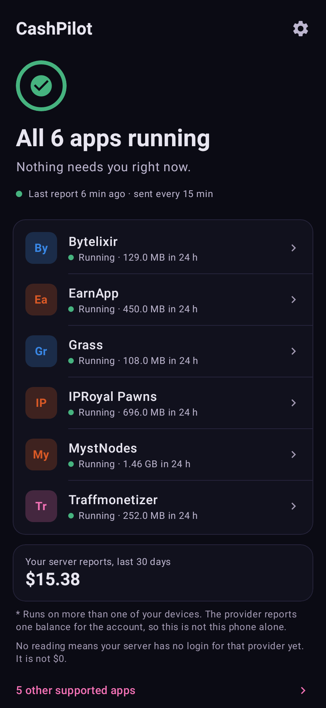
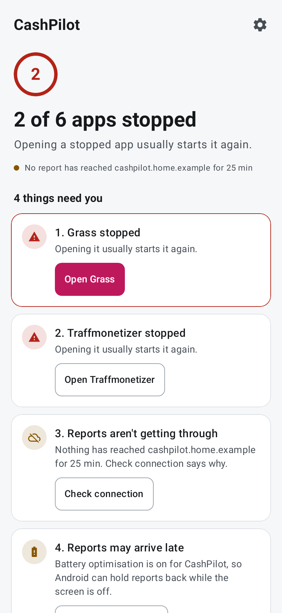

  

# CashPilot Android

**Every earner, every box, one view.** Website: https://cashpilot.club, on X: https://x.com/CashPilotClub

CashPilot Android is the Android agent of [CashPilot](https://github.com/GeiserX/CashPilot), the self-hosted dashboard for bandwidth sharing, DePIN, mining, GPU compute and storage earners. It checks, without root, which earning apps are installed and running on your phone, and reports them to your CashPilot fleet, so the phone shows up next to your servers and desktops.

  
  

## Features

- Watches 10 earning apps: EarnApp, IPRoyal Pawns, MystNodes, Traffmonetizer, Bytelixir, ByteBenefit, Grass, Titan Network, Nodle Cash, Wipter
- One line says whether every app is running; when one is not, the home screen says what and gives the button that fixes it, such as **Open**
- Detects each app from its ongoing notification, and confirms activity from its network traffic and recent use
- Joins your fleet: a report every 15 minutes through WorkManager, so the phone appears next to Docker workers and CashPilot Desktop
- Test connection sends one report and tells you whether the server answered and accepted your key
- Sends data only to your own CashPilot server or CashPilot Desktop, and to nothing else
- Setup explains each permission before Android asks, and you can skip the permissions or the server
- Accessibility tested: 48 dp touch targets, TalkBack labels and order, text at 1.3x, WCAG AA contrast
- No root, no permanent notification and no battery exemption request; Android 8.0 or later

## Quick start

1. Download `app-release.apk` from the [latest release](https://github.com/GeiserX/CashPilot-android/releases/latest) and install it.
2. Grant Notification Access and Usage Access. Turning battery optimisation off for CashPilot is optional and makes late reports less likely; Android can still delay them.
3. In Settings, enter your CashPilot server URL and the fleet key (`CASHPILOT_API_KEY` on the server). Use `https://`; the app accepts `http://` only for a server on your own network: `localhost`, a LAN, link-local or Tailscale address (`192.168.x.x`, `10.x.x.x`, `172.16-31.x.x`, `169.254.x.x`, `100.64-127.x.x`), or a private name (`.local`, `.lan`, `.home.arpa`, `.internal`, Tailscale `.ts.net`).

Needs Android 8.0 (API 26) or later. To report to a server, it needs a reachable CashPilot server, 1.73.2 or newer (including 2.x), or CashPilot Desktop 0.39.6 or newer (including 1.x).

## Documentation

Everything below is on the site, https://geiserx.github.io/CashPilot-android/.

- [Getting started](https://geiserx.github.io/CashPilot-android/getting-started/): install the APK, the first-run steps, and what a working start looks like
- [Usage](https://geiserx.github.io/CashPilot-android/usage/): the home screen, what each app state means, earnings, settings
- [Configuration](https://geiserx.github.io/CashPilot-android/configuration/): every setting, the fleet key and enrollment, heartbeat timing, the app list
- [How it works](https://geiserx.github.io/CashPilot-android/how-it-works/): the three detection APIs, the running rule, what a heartbeat carries, privacy
- [Troubleshooting](https://geiserx.github.io/CashPilot-android/troubleshooting/): symptom, cause, fix, and what to put in a bug report
- [Development](https://geiserx.github.io/CashPilot-android/development/): building, tests, releases, the stack
- [Related projects](https://geiserx.github.io/CashPilot-android/related/): the CashPilot server, desktop app and integrations

## Related projects

[CashPilot](https://github.com/GeiserX/CashPilot), [CashPilot-Desktop](https://github.com/GeiserX/CashPilot-Desktop), [cashpilot-ha](https://github.com/GeiserX/cashpilot-ha), [cashpilot-mcp](https://github.com/GeiserX/cashpilot-mcp).

## License

[GPL-3.0-or-later](LICENSE)
