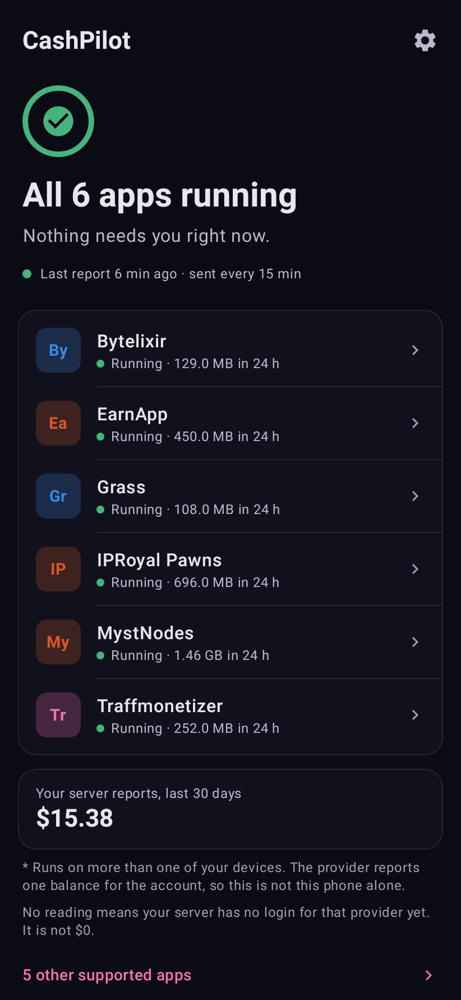
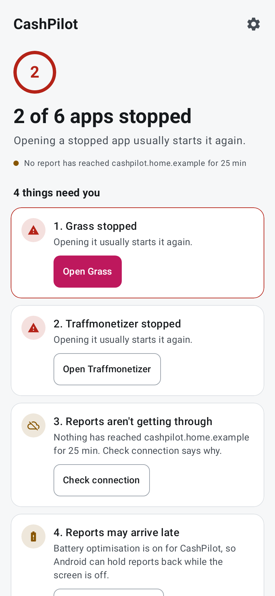

  

# CashPilot Android

CashPilot Android is the Android companion app for [CashPilot](https://github.com/GeiserX/CashPilot). It detects which passive income apps are installed and running on your phone, without root, and reports them to your CashPilot fleet dashboard.

## What's new in 1.0

  
  

- **One line tells you if every app is running.** When something is wrong, the home screen says what and gives you the button to fix it, such as **Open** for a stopped app.
- **Setup explains each permission first.** Three short steps, a plain screen before every Android prompt, and you can skip the permissions or the server.
- **Test connection is a real test.** It sends one report and tells you whether the server answered and accepted your key.
- **Reports every 15 minutes through WorkManager**, with no permanent notification and no battery exemption request, as Google Play's policy expects.
- **Nothing leaves the phone except to your own server.** The public IP lookup is gone.
- **Accessibility is tested**: 48 dp touch targets, TalkBack labels and order, text at 1.3x size, WCAG AA contrast in the Light and Classic night palettes.
- **10 supported apps.**
- **In progress:** inclusion in F-Droid.

CashPilot Android 1.0 ships alongside [CashPilot](https://github.com/GeiserX/CashPilot) 2.0 and [CashPilot Desktop](https://github.com/GeiserX/CashPilot-Desktop) 1.0. The full list is in the [changelog](CHANGELOG.md).

## Features

- Detects 10 passive income apps: EarnApp, IPRoyal Pawns, MystNodes, Traffmonetizer, Bytelixir, ByteBenefit, Grass, Titan Network, Nodle Cash, Wipter
- Instant detection from each app's ongoing notification (NotificationListenerService)
- Confirms activity from per-app network traffic and recent foreground use (NetworkStatsManager, UsageStatsManager)
- Periodic heartbeats to your server (`POST /api/workers/heartbeat`), so phones appear next to Docker workers in the fleet view
- Sends data only to your own CashPilot server, and to nothing else
- No root required; Android 8.0 or later

## Quick start

1. Download `app-release.apk` from the [latest release](https://github.com/GeiserX/CashPilot-android/releases/latest) and install it.
2. Grant Notification Access and Usage Access. Turning battery optimisation off for CashPilot is optional and makes late reports less likely; Android can still delay them.
3. In Settings, enter your CashPilot server URL and the fleet key (`CASHPILOT_API_KEY` on the server). Use `https://`; the app accepts `http://` only for a server on your own network: `localhost`, a LAN, link-local or Tailscale address (`192.168.x.x`, `10.x.x.x`, `172.16-31.x.x`, `169.254.x.x`, `100.64-127.x.x`), or a private name (`.local`, `.lan`, `.home.arpa`, `.internal`, Tailscale `.ts.net`).

Needs Android 8.0 (API 26) or later. To report to a server, it needs a reachable CashPilot server, 1.73.2 or newer (including 2.x), or CashPilot Desktop 0.39.6 or newer (including 1.x).

## Documentation

Everything below is on the site, https://geiserx.github.io/CashPilot-android/.

- [Getting started](https://geiserx.github.io/CashPilot-android/getting-started/): install the APK, the first-run steps, and what a working start looks like
- [Usage](https://geiserx.github.io/CashPilot-android/usage/): the home screen, what each app state means, earnings, settings
- [Configuration](https://geiserx.github.io/CashPilot-android/configuration/): every setting, the fleet key and enrollment, heartbeat timing, the app list
- [How it works](https://geiserx.github.io/CashPilot-android/how-it-works/): the three detection APIs, the running rule, what a heartbeat carries, privacy
- [Troubleshooting](https://geiserx.github.io/CashPilot-android/troubleshooting/): symptom, cause, fix, and what to put in a bug report
- [Development](https://geiserx.github.io/CashPilot-android/development/): building, tests, releases, the stack
- [Related projects](https://geiserx.github.io/CashPilot-android/related/): the CashPilot server, desktop app and integrations

## Related projects

[CashPilot](https://github.com/GeiserX/CashPilot), [CashPilot-Desktop](https://github.com/GeiserX/CashPilot-Desktop), [cashpilot-ha](https://github.com/GeiserX/cashpilot-ha), [cashpilot-mcp](https://github.com/GeiserX/cashpilot-mcp).

## License

[GPL-3.0-or-later](LICENSE)
